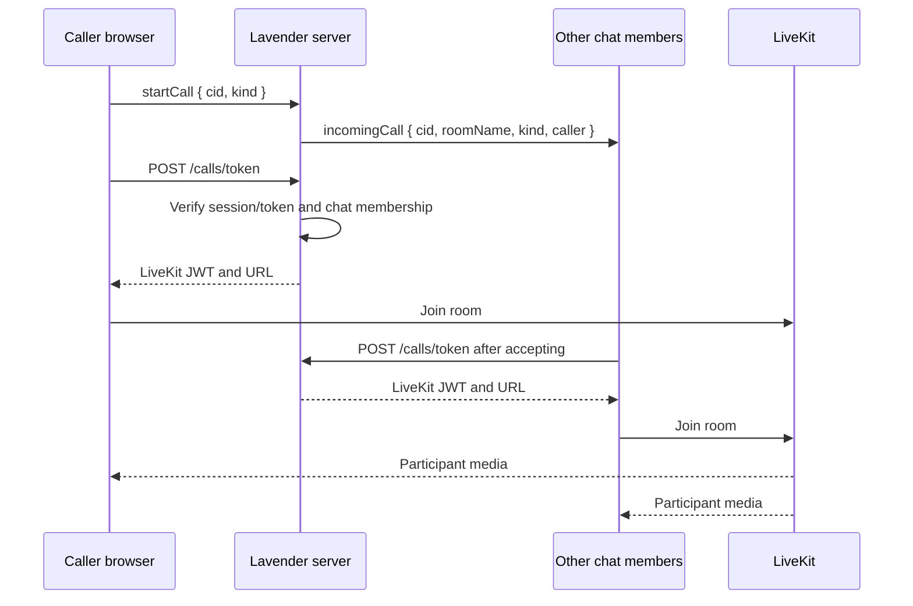

# 16. Audio and Video Calls

## Overview

Lavender uses **LiveKit** for real-time audio and video media. LiveKit is an
SFU (selective forwarding unit), which means browsers publish one media stream
to LiveKit and subscribe to the other participants through the media server.
This is more reliable than a full peer-to-peer mesh for group calls and keeps
the application server out of the media path.

Socket.IO remains the application control channel. It announces calls to
members of the current chat and LiveKit handles room membership and media.



## Call lifecycle

1. A member opens a direct or group chat and selects audio or video call.
2. The client emits `startCall` over the existing authenticated Socket.IO
   connection.
3. The server verifies that the caller belongs to the chat, then broadcasts an
   `incomingCall` event to the other chat members.
4. A participant accepts the invitation and requests a short-lived LiveKit
   token from `POST /calls/token`.
5. The server verifies the caller's session or signed OAuth socket token and
   confirms membership in the requested chat.
6. The client joins the room named `lavender-{chatId}` using LiveKit.
7. A participant leaves by disconnecting from LiveKit and emitting `endCall`.

The server never accepts a client-supplied LiveKit API key or secret. LiveKit
credentials remain server-only.

## Socket events

### `startCall`

```js
socket.emit('startCall', {
  cid: chatId,
  kind: 'audio' // or 'video'
});
```

Recipients receive:

```js
{
  cid,
  roomName: `lavender-${cid}`,
  kind,
  caller: { id, name }
}
```

### `endCall`

```js
socket.emit('endCall', { cid: chatId });
```

This notifies other members that the caller has ended the application-level
call. LiveKit remains responsible for the authoritative participant
disconnect.

## Environment

### Server

Set these variables in `server/.env`:

| Variable | Description |
|---|---|
| `LIVEKIT_URL` | LiveKit WebSocket URL. For local Docker development use `ws://localhost:7880`; use your `wss://...` URL in production. |
| `LIVEKIT_API_KEY` | LiveKit server API key |
| `LIVEKIT_API_SECRET` | LiveKit server API secret |

### Client

Set this build-time variable in `client/.env`:

| Variable | Description |
|---|---|
| `VITE_LIVEKIT_URL` | Optional client-side LiveKit URL. The token endpoint currently returns the authoritative URL. |

The client also needs camera and microphone permission. Browsers only permit
these permissions in secure contexts (`https://` or `localhost`).

## Deployment requirements

- Use a LiveKit Cloud project or a self-hosted LiveKit deployment.
- Configure the LiveKit project's allowed origins for the deployed client.
- Keep `LIVEKIT_API_SECRET` exclusively in the server environment.

## Local development

The repository Compose stack includes a development LiveKit server. Start it
with:

```bash
docker compose up livekit mongo server
```

The development server uses LiveKit's `--dev` mode with:

```env
LIVEKIT_URL=ws://localhost:7880
LIVEKIT_API_KEY=devkey
LIVEKIT_API_SECRET=secret
```

These credentials are intentionally development-only. Replace all three
values with production credentials before deploying.
- Use HTTPS for the client and server in production.
- Configure TURN support through LiveKit for users behind restrictive NATs or
  corporate firewalls.
- A persistent Node process is still required for Socket.IO call invitations.
- If the application is scaled to multiple server instances, Socket.IO needs a
  shared adapter so call invitations can cross instances.

## Current scope and future work

The first integration supports one-to-one calls and group calls using a shared
chat room. Future improvements should add:

- ringing timeouts and missed-call history,
- explicit busy/decline states,
- participant limits and group moderation,
- screen sharing,
- device selection and camera/microphone controls,
- reconnect and network-quality UI,
- call permissions and mute state synchronized in the chat,
- call records or system messages when a call starts and ends.

## Strategy: build around existing Lavender boundaries

The call feature should extend the current application rather than create a
parallel chat platform:

| Existing boundary | Strategy |
|---|---|
| Authentication | Reuse the Passport session carried by Socket.IO. Also accept the existing short-lived signed token used after Google OAuth. Never add a second user identity system. |
| Chat membership | Reuse `Chats.users` and the server's per-connection `chatSet`. A user may invite or join a call only for a chat they already belong to. |
| Real-time control | Reuse the single Socket.IO connection created by `AppScreen.jsx`. Socket.IO carries invitations and lifecycle notifications, not media. |
| Media transport | Use LiveKit SFU. Do not implement offer/answer/ICE mesh signaling in application code. |
| Client state | Keep call state ephemeral in `AppScreen`/call UI. Do not put live tracks, device objects, or access tokens in IndexedDB. |
| Chat history | Do not create message records in the MVP. Add call history/system messages only after lifecycle semantics are stable. |
| Deployment | Keep the existing Vercel/static-client plus persistent Node server split. Add LiveKit Cloud or a separately operated LiveKit deployment. |
| Theming | Use the existing semantic surface/text/accent tokens so the call overlay works in light and dark mode. |

This keeps the existing message sync model unchanged: IndexedDB continues to
cache chats, profiles, and messages, while LiveKit owns transient media state.

## Phased implementation plan

### Phase 0 — Documentation and provider setup

- Confirm LiveKit Cloud versus self-hosting.
- Create development and production LiveKit projects.
- Configure allowed client origins and TURN support.
- Add server-only credentials to deployment environments.
- Define supported browsers, mobile breakpoints, and the initial participant
  limit before public rollout.

**Exit criteria:** local calls work from `localhost` or HTTPS, and no secret
appears in the client bundle.

### Phase 1 — Secure 1:1 MVP

- Add `POST /calls/token` to the existing Express service.
- Authenticate with the existing session or signed OAuth token.
- Validate the chat id, canonical room name, and `Chats.users` membership.
- Add `startCall`, `incomingCall`, and `endCall` Socket.IO events.
- Build ringing, answer, decline, hang-up, mute, camera, permission-error,
  loading, and connection-failure states.
- Clean up on route changes, socket disconnect, refresh, and unmount.

**Exit criteria:** two members can complete repeated audio and video calls,
leave cleanly, and recover from a temporary LiveKit disconnect.

### Phase 2 — Small group calls

- Keep one room per active chat call (`lavender-{chatId}`) initially.
- Invite members through Socket.IO, but require explicit acceptance; never
  auto-enable cameras or microphones.
- Use LiveKit's participant grid and active-speaker layout.
- Enforce a documented participant limit at the application layer.
- Add participant join/leave updates and a “call already in progress” state.
- Initially allow one active call per chat; reject or replace later calls
  explicitly rather than creating ambiguous room behavior.

**Exit criteria:** the supported group size works on desktop and mobile with
stable participant rendering and no cross-chat room access.

### Phase 3 — Reliability and product integration

- Add reconnect state, network-quality indicators, and device selection.
- Add screen sharing only after camera/microphone flows are stable.
- Add ringing timeout, missed-call, busy, and decline semantics.
- Add optional call system messages or a `Call` collection only when history,
  analytics, or moderation requirements justify persistence.
- Add call push notifications only after the existing push subsystem is
  designed.

### Phase 4 — Scale and operations

- Add a Redis Socket.IO adapter before multiple Lavender server instances so
  invitations reach sockets connected to another instance.
- Keep LiveKit as the media scaling layer; never route media through Node.
- Rate-limit token issuance and call invitations.
- Add provider metrics/webhooks where needed.
- Define retention and privacy rules before storing call metadata.

## Compatibility and migration rules

1. Calls are additive. Existing signup, OAuth, message sync, IndexedDB caching,
   and chat schemas must work when LiveKit is unavailable.
2. Missing LiveKit configuration must show an explicit unavailable state, not a
   broken call overlay.
3. A failed token request must not disconnect the message socket.
4. Tokens must be short-lived and scoped to one canonical room. Never accept a
   client-provided LiveKit grant or secret.
5. Membership is checked at token issuance, not only at invitation time, so
   removed group members cannot join.
6. Clear call state when the selected chat changes; a call must not render as
   belonging to another chat.
7. Never cache call tokens, camera frames, microphone data, or LiveKit
   participant state in IndexedDB.

## Test strategy

### Unit and integration

- reject missing auth, malformed chat ids, unknown rooms, and non-members;
- accept both session-cookie and signed OAuth-token authentication;
- normalize audio/video kind and reject unauthorized call events;
- prevent removed members from obtaining a new token;
- return an explicit service-unavailable response when LiveKit is unconfigured.

### Browser and device matrix

Test Chrome/Edge/Firefox/Safari desktop, iOS Safari, and Android Chrome in
light/dark themes with camera denied, microphone denied, both denied, refresh,
background/foreground, route change, socket reconnect, and TURN-required
networks.

### Failure and load tests

Test many invite recipients who do not join, concurrent calls in different
chats, token rate limiting, LiveKit downtime while messaging remains available,
and one versus multiple Lavender server instances.

## Decisions intentionally deferred

- **P2P mesh:** rejected for the planned group scope because browser upload
  grows with participant count and reliability degrades quickly.
- **Custom mediasoup service:** deferred until Lavender has call-scale needs.
- **Call history in MongoDB:** deferred until retention, deletion, moderation,
  and privacy behavior are defined.
- **Automatic camera/microphone activation:** rejected because permission and
  privacy require explicit user action.
